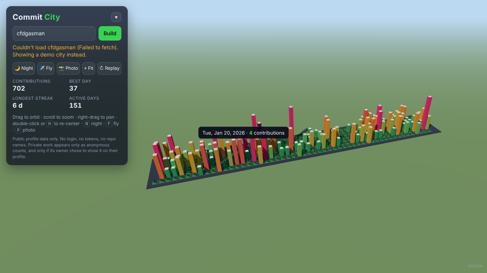
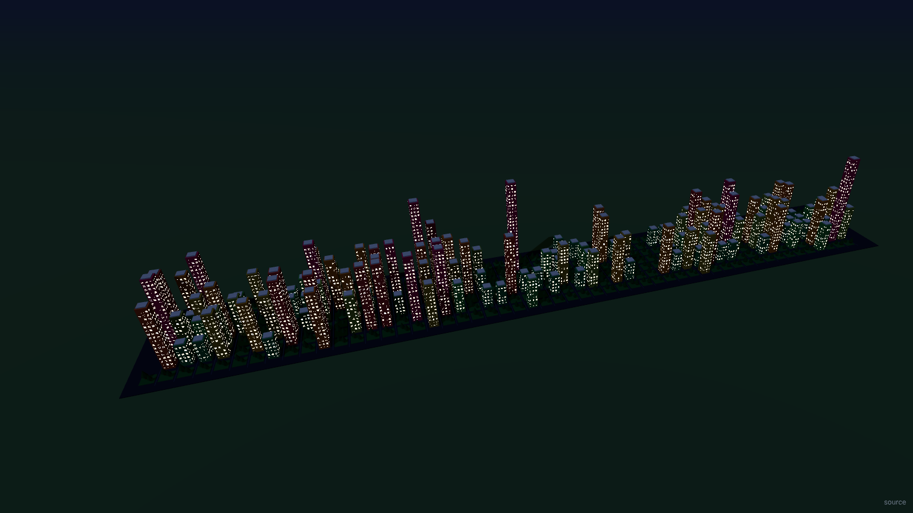
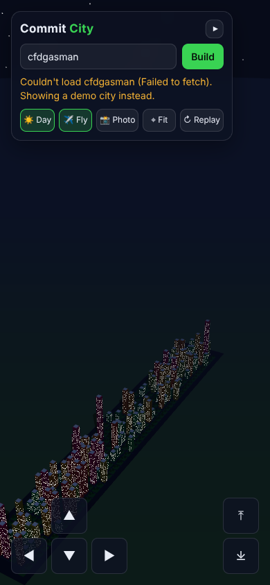

# Commit City

Your GitHub contribution history, rebuilt as a 3D city you can fly through in the browser.

**[▶ Live demo: cfdgasman.github.io/commit-city](https://cfdgasman.github.io/commit-city/)**

Every day you coded becomes a building. Busier days make taller, brighter towers, days off become little parks, and each week forms a street. Type any GitHub username and watch their year rise out of the ground.





## Features

- **Any user:** type a GitHub username, or share a link like [`?user=torvalds`](https://cfdgasman.github.io/commit-city/?user=torvalds)
- **One building per day:** a 53 × 7 grid, like the contribution graph. Height uses a log scale and color runs from teal to hot pink
- **Orbit camera:** drag to orbit, scroll or pinch to zoom, right-drag or two fingers to pan
- **Always fits:** the whole city is framed for any screen size, and it re-fits when you resize or rotate your phone. Lost? Press <kbd>H</kbd>, the **⌖ Fit** button, or double-click/double-tap to glide back
- **Fly camera:** press <kbd>F</kbd>, drag to look, <kbd>W</kbd><kbd>A</kbd><kbd>S</kbd><kbd>D</kbd> to move, <kbd>Q</kbd>/<kbd>E</kbd> down/up, <kbd>Shift</kbd> to boost
- **Hover or tap** a building to see its date and count
- **Day/night toggle** (<kbd>N</kbd>): the sun sets, the stars come out and the windows light up. Add `&night=1` to a link to start at night
- **Intro animation:** the skyline rises week by week as the camera swoops in. Press <kbd>R</kbd> to replay it
- **Photo export** (<kbd>P</kbd>): saves a PNG with a caption
- **Mobile friendly:** touch orbit and pinch zoom, plus an on-screen flight pad in fly mode



## Privacy: public data only

Commit City only reads the **public** contribution calendar that anyone can see on a GitHub profile. There's no login and no token, and it never sees repository names, code or commit messages. It only gets a count per day.

GitHub lets each person choose whether their profile graph includes private contributions (as anonymous counts). To make your city show **only public work**, turn that off. On GitHub, open your profile, click **Contribution settings** above the contribution graph, and untick **Private contributions**. Your city will then match your public activity.

## How it works

- Plain HTML, CSS and JavaScript modules. There is no build step.
- [Three.js](https://threejs.org/) 0.160.0, loaded from jsDelivr through an import map.
- Contribution data comes from the public [github-contributions-api](https://github.com/grubersjoe/github-contributions-api), which needs no token. If it can't be reached, or the user doesn't exist, the app falls back to the bundled `demo-data.json` and says so.
- Towers are instanced meshes. The windows are drawn by a small shader patch on `MeshStandardMaterial`, so the whole city takes only a handful of draw calls.

| File | What it does |
| --- | --- |
| `index.html`, `style.css` | Page, panel and touch controls |
| `src/main.js` | Scene, lighting, camera, intro, day/night, tooltip, screenshot |
| `src/city.js` | Turns days into a grid of towers and parks |
| `src/fly.js` | Fly camera, including the touch pad |
| `src/data.js` | API fetch, demo fallback, stats |
| `scripts/make-demo-data.mjs` | Regenerates `demo-data.json` |

## Run locally

Serve the folder with any static server. Opening the file directly won't work, because ES modules need HTTP:

```bash
npx serve .
# or
python3 -m http.server
```

## Deploy

`.github/workflows/pages.yml` publishes the site to GitHub Pages on every push to `main`. If the first run fails because Pages is disabled, go to **Settings → Pages**, set **Source** to **GitHub Actions**, and re-run the workflow.
